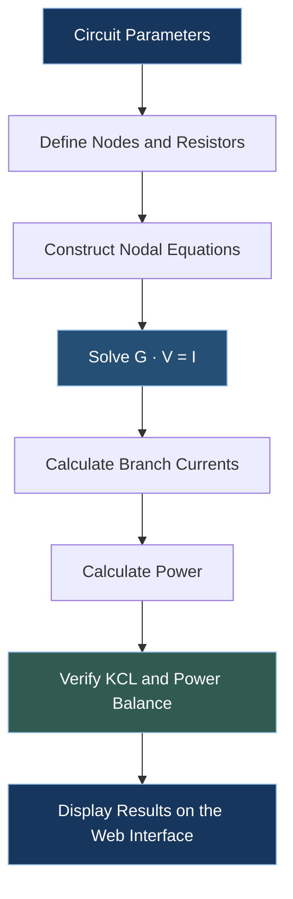

# ⚡ CircuitLab
### A Web-Based DC Circuit Analysis Tool

<p align="center">
  <strong>Analyze circuits. Understand equations. Build engineering intuition.</strong>
</p>

<p align="center">
  
  
  
  
</p>

---

## Overview

**CircuitLab** is an early-stage engineering project focused on the analysis of DC resistive electrical circuits using nodal analysis.

The goal is to develop a web-based tool that does more than calculate numerical answers. It aims to help users understand the equations behind a circuit, interpret node voltages and branch currents, and verify results using fundamental circuit laws.

This repository represents an initial prototype and is **not a complete circuit simulation platform**. It is being developed as a foundation for a larger engineering project.

## Conceptual Workflow



## How It Works

### 1. Circuit Input

The user specifies a voltage source, its positive node, and resistors connected between named nodes. Node `0` is used as the reference ground.

Example input:

```text
A,0,1000
A,B,2000
B,0,3000
```

Each line follows this format:

`node_a,node_b,resistance_in_ohms`

### 2. Nodal Analysis

The solver applies Kirchhoff's Current Law (KCL) to unknown nodes and constructs a linear system:

\[
G V = I
\]

where:

- \(G\) is the conductance matrix.
- \(V\) is the vector of unknown node voltages.
- \(I\) is the current vector resulting from known voltage nodes.

The system is solved numerically using NumPy.

### 3. Branch Calculations

After determining node voltages, the tool calculates branch currents using Ohm's law:

\[
I_{a\rightarrow b}=\frac{V_a-V_b}{R}
\]

Resistor power is calculated as:

\[
P=\frac{(V_a-V_b)^2}{R}
\]

### 4. Result Verification

The prototype checks the residual current at unknown nodes and compares the power delivered by the voltage source with the total power dissipated by resistors.

These checks help identify numerical inconsistencies, but they do not constitute exhaustive validation for every possible circuit.

## Current Features

- Web interface built with Flask.
- Nodal analysis for supported DC resistive networks.
- Calculation of node voltages and branch currents.
- Calculation of resistor power and source power.
- Basic input validation and singular-system handling.
- KCL residual and power-balance checks.
- A responsive, dark-themed interface.

## Technology Stack

| Technology | Purpose |
|---|---|
| Python | Core application logic |
| Flask | Web application and routing |
| NumPy | Numerical linear algebra |
| HTML | Web interface structure |
| CSS | Visual design and responsive layout |

## Project Structure

```text
circuitlab/
├── app.py
├── circuit_solver.py
├── templates/
│   └── index.html
├── static/
│   └── style.css
└── README.md
```

## Getting Started

### Requirements

- Python 3.10 or newer
- pip

### Installation

Clone the repository:

```bash
git clone https://github.com/arazinalti/circuitlab.git
cd circuitlab
```

Install dependencies:

```bash
python -m pip install flask numpy
```

Run the application:

```bash
python app.py
```

Open the local address displayed by Flask, usually:

```text
http://127.0.0.1:5000
```

> Run this development server locally. Flask's debug mode is not intended for public production deployment.

## Limitations and Development Status

CircuitLab is currently an **incomplete prototype under active development**.

The initial scope is deliberately limited. The current solver is designed for resistive DC networks with one ideal voltage source connected between a specified node and ground.

The following capabilities are not yet implemented or fully validated:

- Arbitrary voltage-source configurations and multiple independent sources.
- Independent or dependent current sources.
- Dependent sources and more general circuit elements.
- Capacitors, inductors, transient analysis, and AC frequency-domain analysis.
- Free-form graphical schematic drawing.
- Automatic circuit topology detection from a diagram.
- Comprehensive validation against a trusted circuit simulator.
- Production deployment, automated testing, and a complete error-reporting system.

The solver's supported circuit configurations and numerical behavior need further testing before it can be relied upon for general engineering work.

## Future Direction

The long-term direction is to develop CircuitLab into a component of a larger engineering project.

Potential development areas include:

- Interactive circuit schematic construction.
- Step-by-step equation generation.
- Improved explanations of sign conventions and current directions.
- Additional circuit elements and source models.
- Visual representations of node voltages and branch currents.
- Automated tests and comparison with established circuit-analysis tools.

These are planned directions, not currently available features.

## Project Purpose

This project is an exploration of how numerical methods, software engineering, and electrical circuit theory can be combined into a practical engineering tool.

The current version is intended as a starting point for further development and may be adapted for use within a larger project.

**CircuitLab is a work in progress. Contributions, technical feedback, and suggestions for improvement are welcome.**

---

<p align="center">
  <sub>Developed as an independent engineering project.</sub>
</p>
