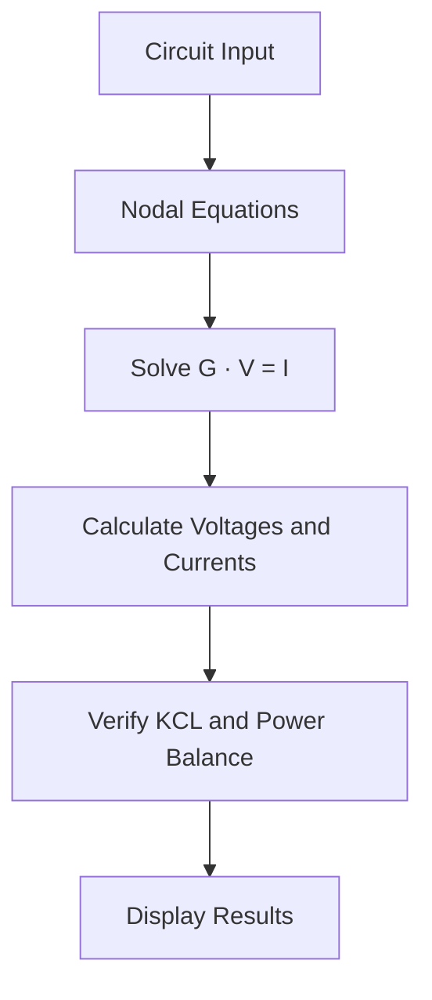

# ⚡ CircuitLab

**A Web-Based DC Circuit Analysis Tool**

CircuitLab is an early-stage engineering project for analyzing DC resistive circuits using nodal analysis. It aims to combine numerical calculations with clear explanations of circuit equations.

> **Status:** Incomplete prototype under development. Intended as a foundation for a larger engineering project.

## How It Works



### Key Equations

The nodal equations are represented as:

$$
GV=I
$$

The current from node \(a\) to node \(b\) is:

$$
I_{a\rightarrow b}=\frac{V_a-V_b}{R}
$$

The power dissipated by a resistor is:

$$
P=\frac{(V_a-V_b)^2}{R}
$$

## Technology Stack

- **Python** — application logic
- **Flask** — web framework
- **NumPy** — numerical calculations
- **HTML & CSS** — user interface

## Current Scope

- DC resistive circuit analysis
- Node voltage and branch current calculations
- Resistor power calculations
- Basic KCL and power-balance checks

## Limitations

CircuitLab is not a complete circuit simulator. The current prototype has limited source configurations and does not yet support general AC analysis, transient analysis, or graphical circuit construction. Further testing and validation are required.

## Setup

```bash
git clone https://github.com/arazinalti/circuitlab.git
cd circuitlab
python -m pip install flask numpy
python app.py
```

Open `http://127.0.0.1:5000` in your browser.

## Future Direction

The project is intended to evolve into a component of a larger engineering project, with potential improvements in circuit visualization, step-by-step explanations, and support for additional circuit elements.

---

*An independent engineering project under active development.*
